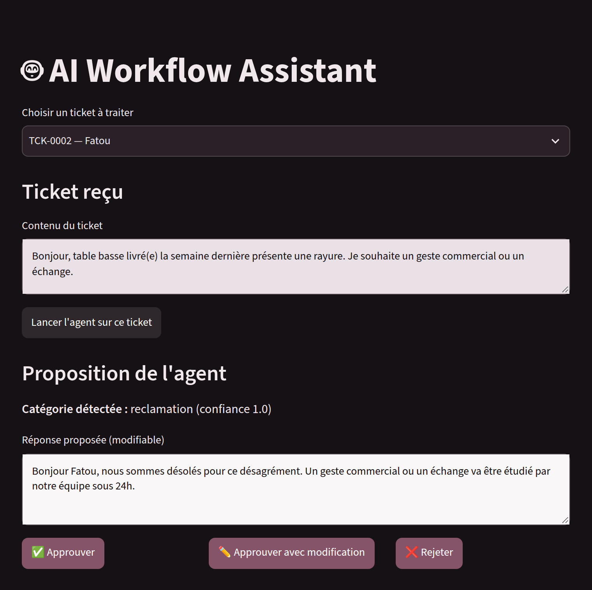
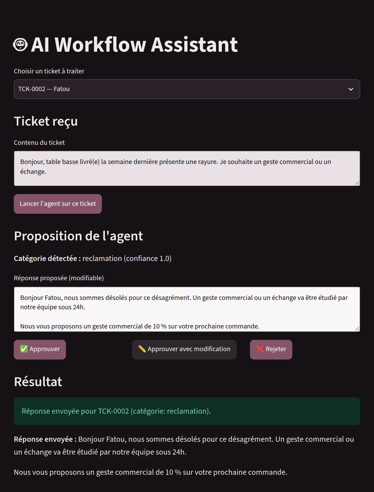
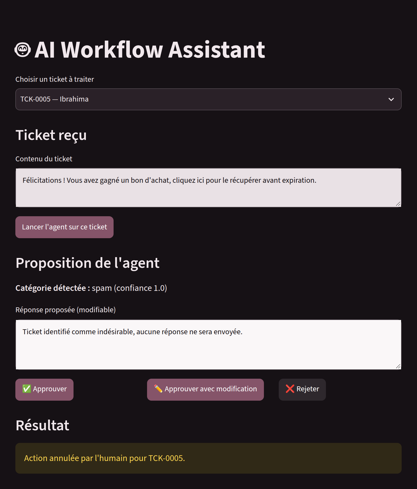

# 🤖 AI Workflow Assistant

> **Projet personnel indépendant** — démonstrateur d'automatisation intelligente avec validation humaine obligatoire (human-in-the-loop).
> Auteure : Soda Ndiaye · [GitHub](https://github.com/data-dash-scientist)

⚠️ **Avertissement de transparence éditoriale** : ce dépôt est un projet personnel que j'ai conçu, codé et documenté en dehors de mon activité professionnelle. Il **n'est pas** le produit "LM-AI-Agent" développé pour mon employeur LO Multimedia, ne réutilise aucun de ses éléments (code, architecture, données, clients) et s'appuie uniquement sur des données et un scénario 100% fictifs ("Atelier Nimba", entreprise imaginaire). Voir [`assets/architecture.md`](assets/architecture.md) pour le détail de cette séparation.

## 1. Contexte et problème

Dans de nombreuses PME, le traitement des e-mails/tickets clients (devis, réclamations, support, facturation) est chronophage et répétitif, mais une automatisation 100% autonome fait courir un risque métier (réponse erronée, engagement commercial non souhaité, mauvaise classification). Ce projet démontre une architecture d'agent IA qui **propose** une classification et une réponse, mais **n'exécute jamais rien sans qu'un humain valide, modifie ou rejette explicitement la proposition**.

## 2. Démo rapide

```bash
git clone https://github.com/data-dash-scientist/ai-workflow-assistant.git
cd ai-workflow-assistant
python3 -m venv .venv
source .venv/bin/activate
pip install -r requirements.txt
streamlit run app.py
```

Aucune clé d'API n'est nécessaire pour la démo par défaut (classifieur par règles, déterministe).

### Captures d'écran

| 1. Proposition de l'agent | 2. Modification et validation humaine | 3. Rejet (spam) |
|---|---|---|
|  |  |  |

## 3. Architecture

Voir le schéma détaillé dans [`assets/architecture.md`](assets/architecture.md). En résumé, le workflow est un graphe [LangGraph](https://langchain-ai.github.io/langgraph/) à 4 nœuds :

```
classify → prepare_action → human_review (interrupt) → execute
```

- **`classify`** : classe le ticket et rédige une réponse suggérée.
- **`prepare_action`** : étape d'orchestration (extensible sans toucher aux autres nœuds).
- **`human_review`** : point d'arrêt obligatoire du graphe (`interrupt()`), persistant via un `checkpointer`, qui attend une décision (`approve` / `edit` / `reject`).
- **`execute`** : simule l'envoi de la réponse validée, ou journalise l'annulation.

| Fichier | Rôle |
|---|---|
| `src/synthetic_data.py` | Génération de tickets clients fictifs (graine fixe, reproductible) |
| `src/classifier.py` | Classification par règles (par défaut) + backend LLM optionnel |
| `src/workflow.py` | Graphe LangGraph, nœud de validation humaine, reprise d'exécution |
| `app.py` | Interface Streamlit de démonstration |
| `evaluation/evaluate.py` | Script de mesure des performances du classifieur |
| `tests/` | Suite de tests unitaires (pytest) |

## 4. Choix techniques

- **LangGraph** pour modéliser explicitement le graphe d'états et le point de validation humaine via le mécanisme natif `interrupt()` / `Command(resume=...)`, plutôt qu'une simple boucle `if/else` — ce choix illustre une architecture extensible (ajout de nœuds, de branches conditionnelles, de reprise après coupure).
- **Classifieur par règles par défaut** (et non un LLM) : ce choix assure que n'importe qui peut cloner le dépôt et exécuter la démo **sans clé d'API ni coût**, tout en gardant l'architecture 100% compatible avec un vrai modèle de langage (voir `LLMClassifier` dans `src/classifier.py`, activable en y branchant un modèle `langchain_core`).
- **Données synthétiques générées par gabarits** plutôt qu'un dataset public de tickets (peu disponibles pour ce cas d'usage précis) : la génération est documentée, reproductible (graine fixe) et ne pose aucun problème de confidentialité.
- **Streamlit** pour l'interface de démonstration, cohérent avec le reste de ma stack data.

## 5. Méthodologie d'évaluation

Le script `evaluation/evaluate.py` génère 200 tickets synthétiques (`seed=42`, répartition égale sur 5 catégories) et calcule, par catégorie : précision, rappel, F1-score, ainsi qu'une matrice de confusion complète.

```bash
python -m evaluation.evaluate
```

## 6. Résultats mesurés (reproductibles)

Exécuté le 13/11/2026, 200 tickets, `seed=42` :

**Exactitude globale (accuracy) : 1.0** — précision/rappel/F1 = 1.0 sur les 5 catégories (devis, réclamation, support technique, facturation, spam).

Résultats complets et matrice de confusion : [`evaluation/results.md`](evaluation/results.md).

## 7. Limites (assumées et documentées)

- **Le score de 1.0 n'est pas une preuve de performance en conditions réelles.** Le classifieur par règles est calé sur les mêmes gabarits que le générateur de données synthétiques : il reconnaît ses propres mots-clés par construction. Ce score mesure la cohérence de l'implémentation, pas une capacité de généralisation.
- **Le jeu de données est fictif et peu diversifié** (pas de fautes d'orthographe, pas d'ambiguïté volontaire, pas de tickets multi-sujets).
- **Le backend LLM n'a pas été évalué quantitativement** dans ce dépôt (nécessite une clé d'API non fournie publiquement).
- **Pas de persistance réelle** : le `MemorySaver` de LangGraph stocke l'état en mémoire ; un déploiement réel nécessiterait un checkpointer persistant (base de données).

## 8. Améliorations possibles

- Remplacer le générateur par gabarits par un jeu de tickets réels anonymisés et annotés manuellement, pour une évaluation plus robuste.
- Activer et évaluer quantitativement le backend `LLMClassifier` (comparaison précision/coût/latence vs règles).
- Ajouter une file d'attente de validation multi-tickets avec historique des décisions humaines (traçabilité/audit).
- Déployer la démo sur Streamlit Community Cloud pour une démonstration en ligne sans installation.

## 9. Tests

```bash
pytest -v
```

13 tests couvrant la génération de données, la classification et le comportement du graphe (arrêt à la validation humaine, exécution conditionnelle à la décision, isolation entre threads).

## 10. Qualification du projet

**Projet personnel indépendant** — conçu, codé et documenté en autonomie, sur mon temps personnel, avec mes propres choix d'architecture et des données fictives. Distinct de toute expérience professionnelle ou académique.
