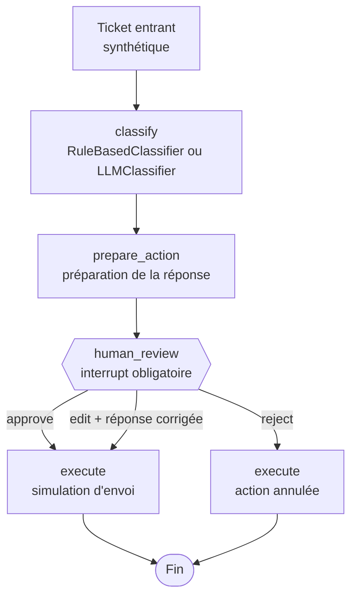

# Architecture — AI Workflow Assistant

Diagramme du graphe LangGraph (format Mermaid, rendu automatiquement par GitHub) :

## Principes de conception

1. **Aucune exécution sans validation humaine.** Le nœud `human_review`
   utilise le mécanisme `interrupt()` de LangGraph : le graphe s'arrête
   littéralement à cette étape, persiste son état via un `checkpointer`
   (`MemorySaver` en démo, remplaçable par un backend persistant en
   production), et attend une décision externe transmise via
   `Command(resume=...)`.
2. **Séparation classification / action.** Le nœud `classify` ne fait que
   proposer une catégorie et une réponse ; il n'a aucun pouvoir
   d'exécution. C'est volontaire : cela permet de changer de backend de
   classification (règles → LLM) sans toucher à la logique de validation
   ni d'exécution.
3. **Deux backends interchangeables.** `RuleBasedClassifier` (par défaut,
   déterministe, sans API) et `LLMClassifier` (optionnel, nécessite un
   modèle de chat LangChain) implémentent la même interface
   `TicketClassifier`, ce qui illustre un principe d'architecture
   réutilisable au-delà de la démo.
4. **Isolation par thread.** Chaque ticket est traité dans un `thread_id`
   LangGraph distinct, ce qui permet de traiter plusieurs tickets en
   parallèle sans interférence d'état (voir
   `tests/test_workflow.py::test_two_independent_threads_do_not_interfere`).

## Différence explicite avec mon travail en entreprise

Ce projet est une démonstration personnelle indépendante. Il ne réutilise
ni le code, ni l'architecture, ni les données de l'agent IA que je
développe pour mon employeur (LO Multimedia). Le scénario ("Atelier
Nimba"), les données et le code de ce dépôt sont entièrement fictifs et
construits par moi en dehors de mon temps de travail.
